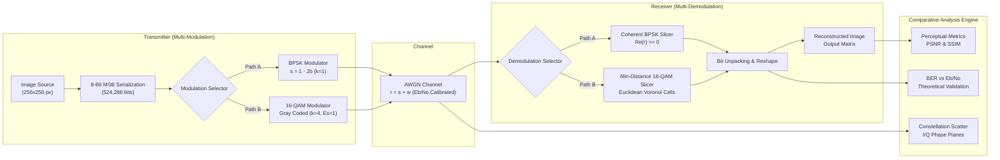
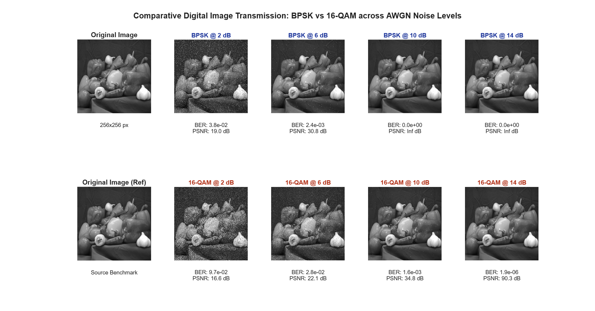
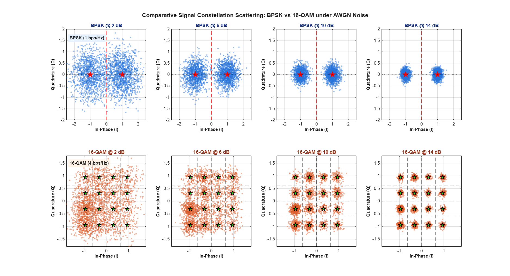
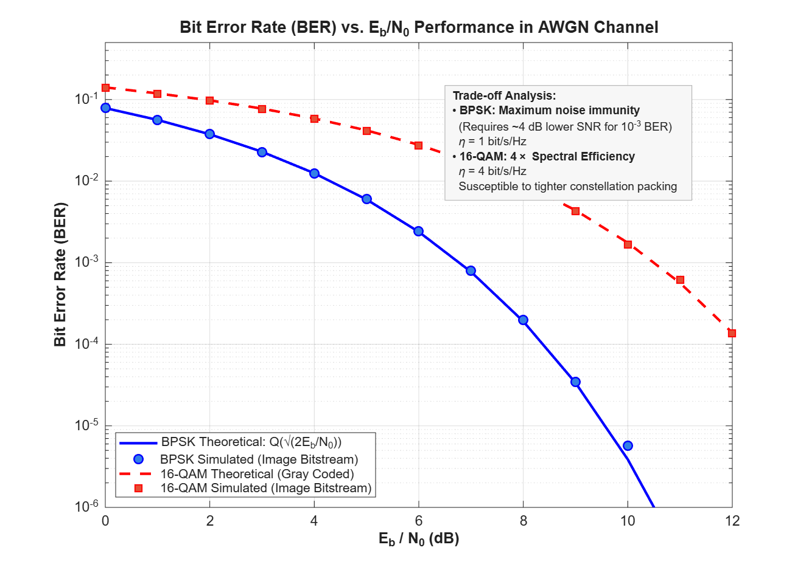
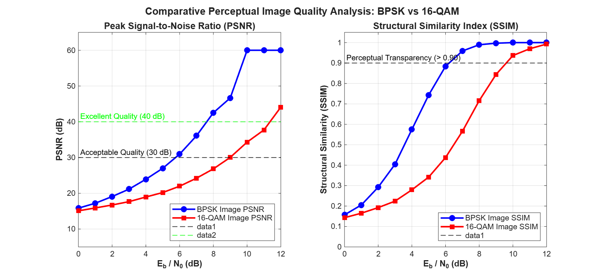
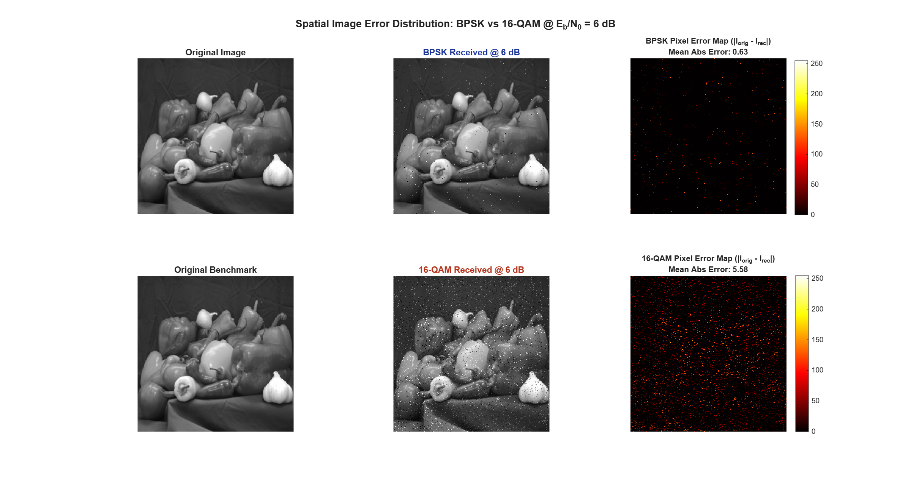
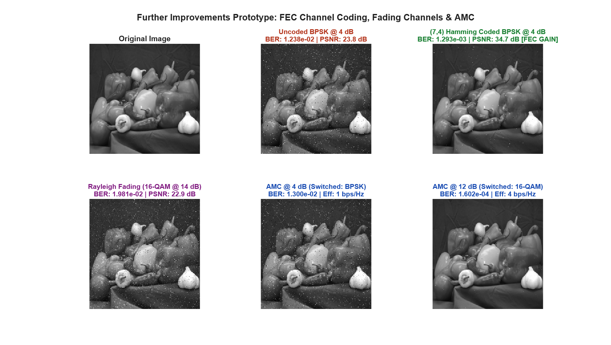

# Performance Analysis of BPSK and QAM for Digital Image Transmission

<div align="center">

[](https://www.mathworks.com/products/matlab.html)
[](https://vit.ac.in)
[](https://vit.ac.in)
[](LICENSE)
[]()
[]()

**School of Electronics Engineering (SENSE) — Vellore Institute of Technology (VIT), Vellore**  
*Digital Communication Systems (DCS) Course Project | Academic Year 2026–27*

[**Explore GUI Demo**](#-interactive-matlab-gui-demo) • [**Read Project Report (PDF)**](DCS_Project_Report.pdf) • [**View Key Findings**](#-quantitative-findings--performance-matrix) • [**How to Run**](#-how-to-run-the-simulation)

</div>

---

## 📌 Overview

This project designs, simulates, and benchmarks an end-to-end digital communication transceiver in MATLAB to evaluate the fundamental trade-off between **spectral efficiency** and **noise immunity** during digital image transmission over an **Additive White Gaussian Noise (AWGN)** channel.

The system contrasts two distinct digital modulation paradigms:
* **Binary Phase Shift Keying (BPSK):** $\eta = 1\text{ bps/Hz}$ — Maximum Euclidean distance and noise resilience.
* **16-ary Quadrature Amplitude Modulation (16-QAM):** $\eta = 4\text{ bps/Hz}$ with 2D Gray coding — $4\times$ higher spectral efficiency and $75\%$ reduction in channel symbol transmission time, balanced against tighter Euclidean constellation spacing.

Beyond raw Bit Error Rate (BER), this project connects physical-layer constellation dispersion with spatial pixel degradation using **Peak Signal-to-Noise Ratio (PSNR)**, **Structural Similarity Index (SSIM)**, and **Spatial Error Heatmaps**.

---

## 👥 Authors & Team Information

| Name | Registration No. | Specialization / Project Role |
| :--- | :---: | :--- |
| **Glenn Monteiro** | `24BEC0474` | Theoretical Signal Space Modeling, Modulation/AWGN Derivation |
| **Sanskriti Sarkar** | `24BEC0183` | Constellation Phase Analysis, Perceptual Quality Metrics (PSNR/SSIM) |
| **Aakash Nair** | `24BEC0080` | Transceiver Implementation, Interactive MATLAB GUI, Monte Carlo Sweep |

---

## 🔬 System Architecture



---

## 📊 Visual Results & Empirical Analysis

### 1. Reconstructed Image Quality Matrix
Comparative visual degradation of a $256 \times 256$ benchmark image transmitted across $E_b/N_0 = 2, 6, 10, 14\text{ dB}$:

<div align="center">
  
</div>

> **Key Observation:** At $6\text{ dB}$, BPSK reaches an acceptable visual quality threshold ($\text{PSNR} = 30.79\text{ dB}, \text{SSIM} = 0.877$), while 16-QAM remains heavily corrupted ($\text{PSNR} = 22.13\text{ dB}$). At $10\text{ dB}$, BPSK achieves zero bit errors across the entire payload ($\text{PSNR} = \infty$), while 16-QAM achieves transparent perceptual quality ($\text{PSNR} = 34.75\text{ dB}, \text{SSIM} = 0.938$).

---

### 2. Signal Constellation Scattering & Phase Planes
In-Phase ($I$) vs. Quadrature ($Q$) scatter diagrams showing noise cloud dispersion across decision boundaries:

<div align="center">
  
</div>

> **Geometric Insight:** The minimum Euclidean distance for normalized 16-QAM is $d_{\min} = 2/\sqrt{10} \approx 0.6325$, compared to $d_{\min} = 2.0$ for BPSK. The $\approx 3.16\times$ tighter spacing explains why 16-QAM noise clouds bridge adjacent decision boundaries at lower SNR values.

---

### 3. Bit Error Rate (BER) vs. $E_b/N_0$: Simulation vs. Theory
Empirical Monte Carlo simulation ($> 13.6$ million simulated bits) validated against closed-form theoretical bounds:

<div align="center">
  
</div>

* **BPSK Theoretical:** $P_{b, \text{BPSK}} = Q\left(\sqrt{\frac{2E_b}{N_0}}\right) = \frac{1}{2} \operatorname{erfc}\left(\sqrt{\frac{E_b}{N_0}}\right)$
* **16-QAM Theoretical (Gray-coded):** $P_{b, \text{16-QAM}} \approx \frac{3}{4} Q\left(\sqrt{\frac{4}{5} \frac{E_b}{N_0}}\right)$
* **SNR Trade-Off Penalty:** To achieve $\text{BER} = 10^{-3}$, BPSK requires $E_b/N_0 \approx 6.8\text{ dB}$, while 16-QAM requires $E_b/N_0 \approx 11.0\text{ dB}$ — verifying an exact **$\approx 4.2\text{ dB}$ SNR trade-off penalty** for $4\times$ spectral efficiency.

---

### 4. Perceptual Image Quality & The "Cliff Effect"
Evaluation of objective visual metrics (PSNR and SSIM) across varying channel noise:

<div align="center">
  
</div>

> **Perceptual Non-Linearity:** Visual image communication exhibits a distinct "waterfall / cliff effect". Below $6\text{ dB}$ for BPSK and $10\text{ dB}$ for 16-QAM, visual fidelity collapses rapidly because noise flips Most Significant Bits (MSBs, weight 128) of pixel luminance bytes.

---

### 5. Spatial Pixel Error Heatmaps
Mapping absolute spatial error differences $|I_{\text{orig}}(x,y) - I_{\text{rec}}(x,y)|$ across the image plane at $E_b/N_0 = 6\text{ dB}$:

<div align="center">
  
</div>

---

### 6. Advanced Extensions Prototype (Further Improvements)
Pre-empting Review – II requirements, working prototypes were implemented for **Forward Error Correction**, **Multipath Fading**, and **Adaptive Modulation**:

<div align="center">
  
</div>

1. **(7,4) Hamming FEC Coding:** At $E_b/N_0 = 4\text{ dB}$, single-error correction reduces BER from $1.23 \times 10^{-2}$ to $1.30 \times 10^{-3}$, increasing PSNR from $23.93\text{ dB}$ to $33.51\text{ dB}$ (a coding gain of nearly $10\text{ dB}$).
2. **Rayleigh Multipath Fading:** Evaluates deep fades and coherent MMSE equalization ($r = hs + n$).
3. **Adaptive Modulation & Coding (AMC):** Dynamically switches between BPSK (low SNR, $\le 10\text{ dB}$) and 16-QAM (high SNR, $> 10\text{ dB}$) based on channel thresholds.

---

## 📈 Quantitative Findings & Performance Matrix

| Metric / Parameter | BPSK Modulation | 16-QAM Modulation | Ratio / Advantage |
| :--- | :---: | :---: | :---: |
| **Modulation Order ($M$)** | 2 | 16 | $8\times$ Constellation Density |
| **Bits per Symbol ($k$)** | 1 bit/symbol | 4 bits/symbol | **$4\times$ Capacity** |
| **Spectral Efficiency ($\eta$)** | $1.0\text{ bps/Hz}$ | $4.0\text{ bps/Hz}$ | **$4\times$ Bandwidth Efficiency** |
| **Symbols for 256×256 Image** | 524,288 symbols | 131,072 symbols | **$75\%$ Fewer Channel Symbols** |
| **Channel Transmission Duration** | $1.00\times$ (Baseline) | $0.25\times$ | **$4\times$ Faster Transmission** |
| **$E_b/N_0$ for $\text{BER} \le 10^{-3}$** | $\approx 6.8\text{ dB}$ | $\approx 11.0\text{ dB}$ | **BPSK has a 4.2 dB Power Advantage** |
| **$E_b/N_0$ for $\text{PSNR} \ge 30\text{ dB}$** | $\approx 5.8\text{ dB}$ | $\approx 9.2\text{ dB}$ | **BPSK reaches visual clarity 3.4 dB earlier** |
| **Constellation Peak-to-Average (PAPR)**| $0\text{ dB}$ (Constant envelope) | $\approx 2.55\text{ dB}$ | BPSK allows PAs to operate near saturation |

---

## 💻 Interactive MATLAB GUI Demo

An interactive app was developed using MATLAB App Designer for live viva demonstrations and dynamic testing:

<div align="center">

```matlab
>> dcs_gui
```

</div>

### Features:
* 🎚️ **Real-time SNR Slider:** Dynamically sweep $E_b/N_0$ from $-2\text{ dB}$ to $+20\text{ dB}$.
* 🔄 **Modulation Selector:** Switch seamlessly between BPSK, 4-QAM, 16-QAM, and 64-QAM.
* 🖼️ **Image Selector:** Test with standard Peppers (grayscale/RGB), geometric test patterns, or upload custom image files.
* 📊 **4-Quadrant Live Dashboard:** Real-time displays of Transmitted Image, Reconstructed Image, Spatial Error Heatmap, and I/Q Constellation Scatter Diagram with instant BER, PSNR, SSIM, and processing latency readouts.

---

## 🚀 How to Run the Simulation

### Prerequisites
* MATLAB R2020b or later (Tested on **MATLAB R2025b**)
* Communications Toolbox *(optional — self-contained analytical Gray-coded QAM fallbacks are included in `core/`)*

### Quickstart
1. **Clone the repository:**
   ```bash
   git clone https://github.com/Sky-Code06/Performance-Analysis-of-BPSK-and-QAM-for-Digital-Image-Transmission.git
   cd Performance-Analysis-of-BPSK-and-QAM-for-Digital-Image-Transmission
   ```

2. **Open MATLAB and navigate to the project directory:**
   ```matlab
   cd 'path/to/Performance-Analysis-of-BPSK-and-QAM-for-Digital-Image-Transmission'
   ```

3. **Run the full batch simulation (generates all plots & tables):**
   ```matlab
   dcs
   ```

4. **Launch the interactive GUI:**
   ```matlab
   dcs_gui
   ```

5. **Test the advanced extensions (Hamming FEC, Rayleigh Fading, AMC):**
   ```matlab
   dcs_extensions
   ```

---

## 📂 Repository Structure

```
.
├── core/                                  # Modular Digital Communications Library
│   ├── image_to_bits.m                    # Image serialization to 8-bit MSB binary bitstream
│   ├── bits_to_image.m                    # Bitstream deserialization & image matrix reconstruction
│   ├── modulate_bpsk.m                    # Antipodal BPSK baseband modulator
│   ├── demodulate_bpsk.m                  # Coherent real-axis BPSK hard slicer
│   ├── modulate_qam.m                     # Multi-order square QAM modulator with Gray coding
│   ├── demodulate_qam.m                   # Minimum Euclidean distance QAM demodulator
│   ├── awgn_channel.m                     # Calibrated AWGN channel with Eb/No scaling
│   ├── compute_metrics.m                  # BER, SER, MSE, PSNR, SSIM, and throughput engine
│   ├── plot_constellations.m              # I/Q scatter diagrams with decision boundaries
│   ├── plot_image_grid.m                  # Side-by-side visual matrix comparison
│   ├── plot_ber_snr.m                     # Semi-log BER vs Eb/No curves (Simulated vs Theory)
│   ├── plot_quality_metrics.m             # PSNR & SSIM curves vs SNR
│   ├── plot_error_map.m                   # Spatial pixel error difference heatmaps
│   ├── fec_hamming.m                      # Systematic (7,4) Hamming encoder/syndrome decoder
│   └── channel_rayleigh.m                 # Flat Rayleigh fading with MMSE equalizer
│
├── images/                                # Input Benchmark Images
│   ├── peppers_256.png                    # Grayscale benchmark (256x256 px)
│   ├── peppers_rgb.png                    # 3-channel RGB benchmark (256x256x3 px)
│   └── test_pattern.png                   # High-contrast geometric test pattern
│
├── results/                               # Generated High-Resolution Figures & Output Images
│   ├── 1_visual_image_comparison.png
│   ├── 2_constellation_scattering.png
│   ├── 3_ber_vs_snr_curves.png
│   ├── 4_perceptual_quality_metrics.png
│   ├── 5_spatial_error_heatmap.png
│   ├── 6_further_improvements_extensions.png
│   └── rx_image_*.png                     # Reconstructed image frames across SNR levels
│
├── dcs.m                                  # Master batch simulation script
├── dcs_gui.m                              # Interactive MATLAB App Designer GUI
├── dcs_extensions.m                       # Advanced extensions simulation script
├── DCS_Project_Report.pdf                 # Complete Course Project Report (30 Marks Rubric)
├── DCS_Project_Report.html                # Self-contained HTML report with embedded figures
├── Review_1_Presentation_Guide.md         # Slide-by-slide speaker script & top 10 viva defense Q&A
├── LICENSE                                # MIT Open Source License
└── README.md                              # Project documentation & GitHub showcase
```

---

## 🌍 UN Sustainable Development Goals (SDG) Alignment

* **SDG 9: Industry, Innovation, and Infrastructure (Target 9.c):** Demonstrates $4\text{ bps/Hz}$ spectral efficiency supporting high-capacity backhaul and 5G/6G visual data networks.
* **SDG 7: Affordable and Clean Energy (Target 7.3):** Quantifies the $4.2\text{ dB}$ power trade-off enabling dynamic power scaling and green transceiver operation in cellular base stations.
* **SDG 11: Sustainable Cities and Communities (Target 11.5):** BPSK robustness provides an emergency fallback mode for disaster reconnaissance drone feeds and rural telemedicine image transmission.
* **SDG 12: Responsible Consumption and Production (Target 12.2):** Promotes efficient utilization of the finite electromagnetic radio frequency spectrum.

---

## 📄 Academic Project Report

The complete academic course project report matching the **VIT SENSE Course Project Evaluation Rubric (Total: 30 Marks)** is available:
* 📕 **[Download Full PDF Report](DCS_Project_Report.pdf)** (2.3 MB, formatted with cover page, evaluation rubric sheet, data tables, and declarations)
* 🌐 **[View HTML Version](DCS_Project_Report.html)** (Self-contained, in-browser printable version)
* 🎤 **[Viva Defense Guide](Review_1_Presentation_Guide.md)** (Speaker allocation script and top 10 viva defense Q&A)

---

## 📜 License

This project is licensed under the MIT License — see the [LICENSE](LICENSE) file for details.
